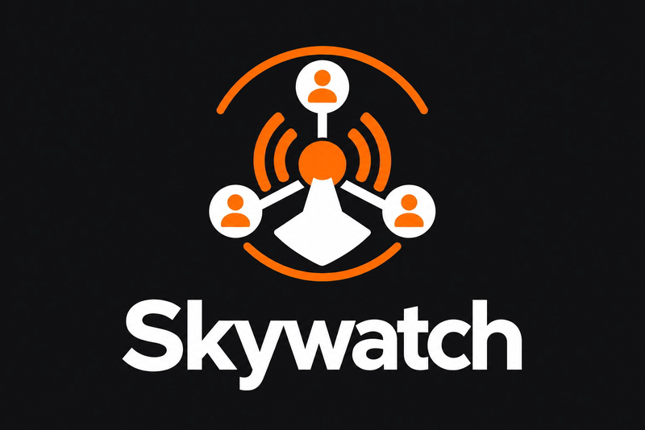
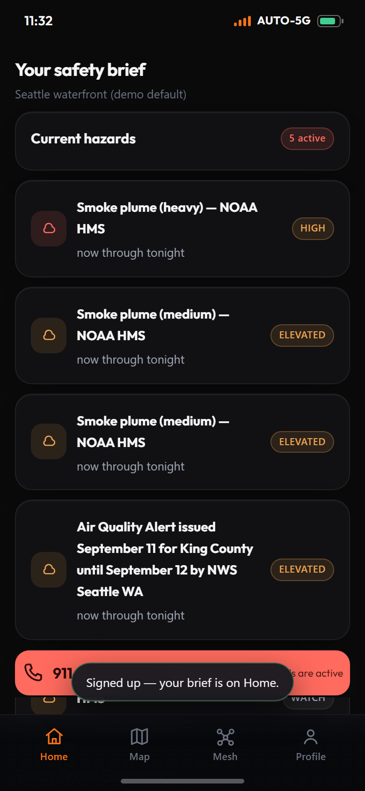
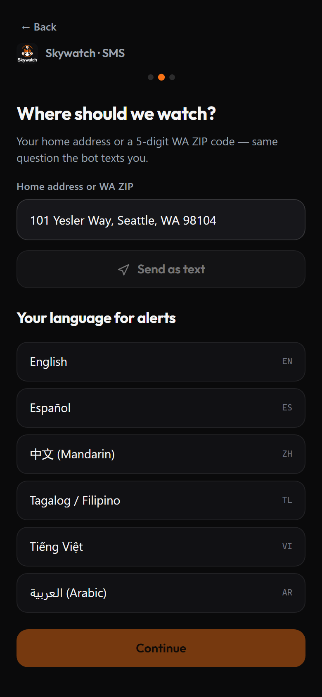
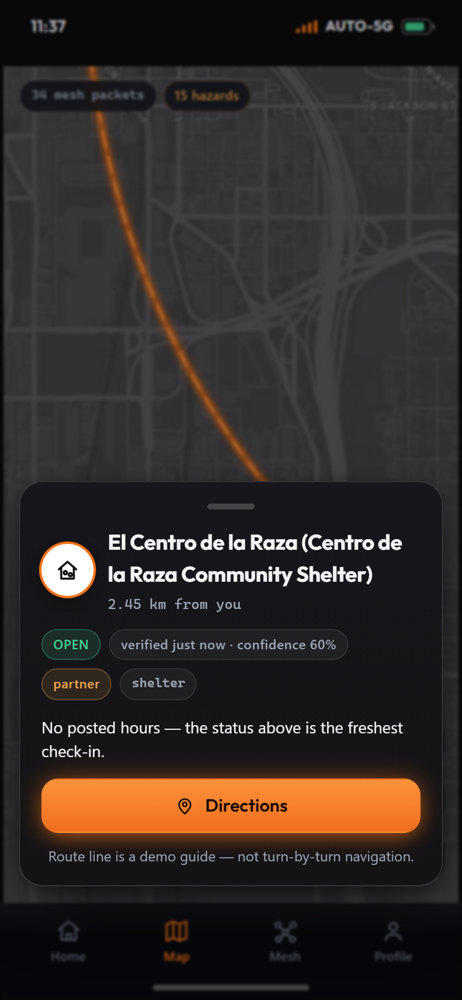
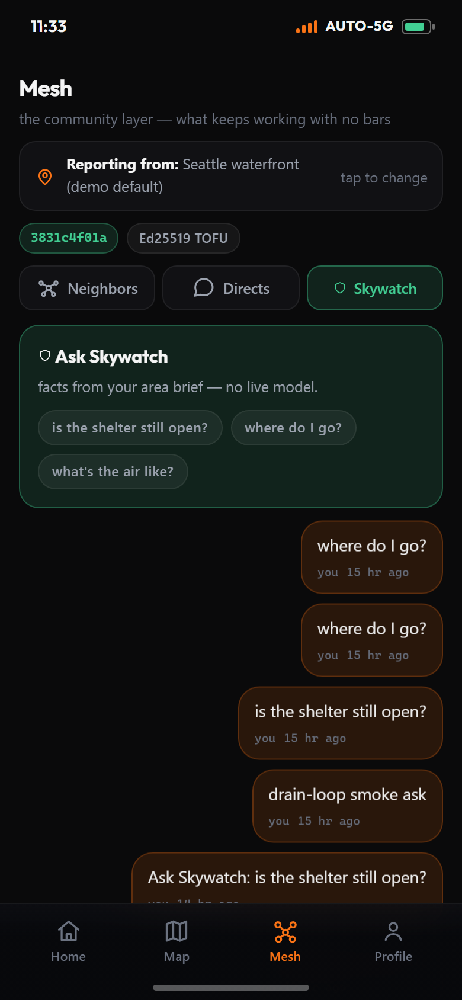
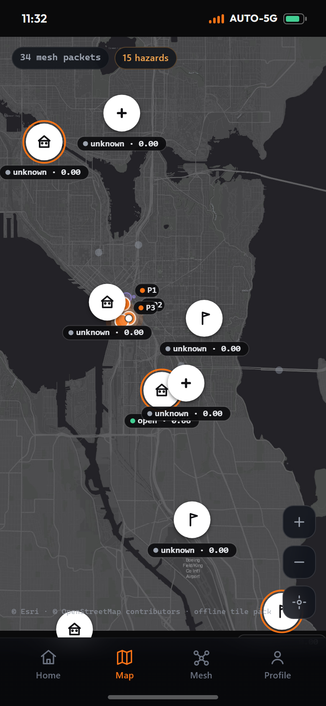
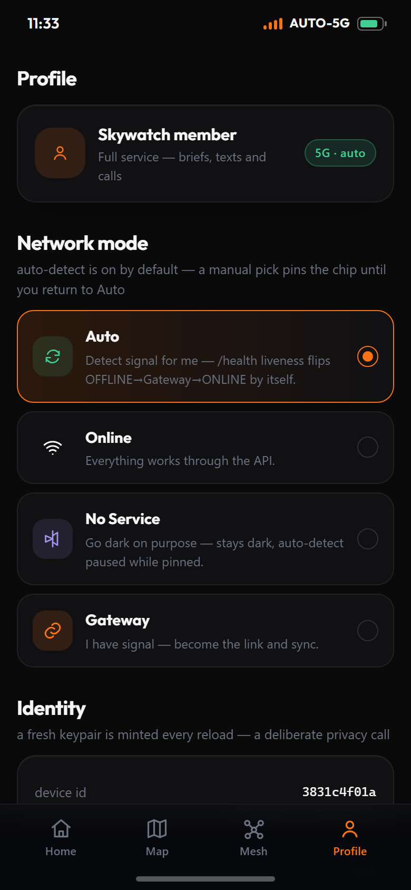
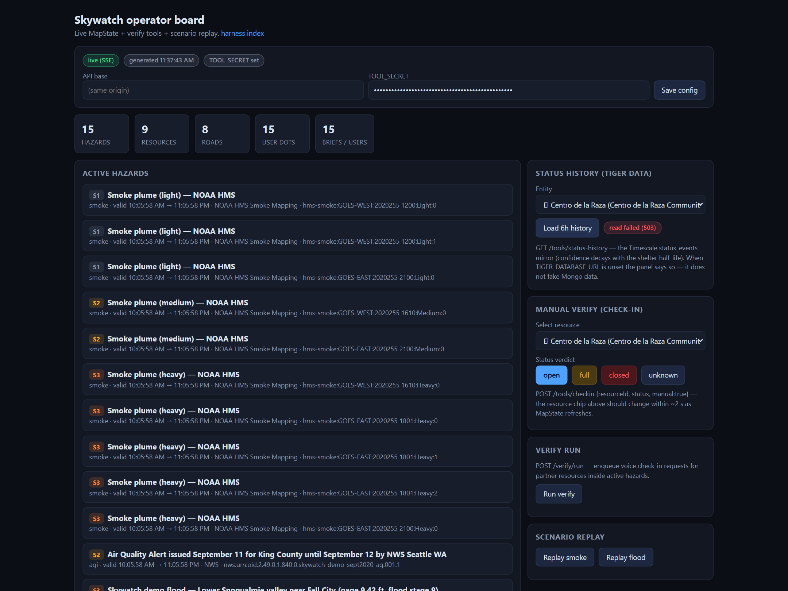

<p align="center">
  
</p>

# Skywatch

> **Emergency updates that keep working when the towers don't.**

Official alerts go to a whole county, in English, and don't know which shelter is open. Skywatch teaches each household what to do — in its own language, over text or a phone call — and when the network dies, the phones around you *become* the network.

<p align="center">
  <a href="https://youtu.be/F6wOvyp8ZXY" title="Watch the demo (backup video)">
    
  </a>
</p>

**[▶ Watch the demo video](https://youtu.be/F6wOvyp8ZXY)** (backup) · **[🚀 Try the live app](https://skywatch-9kvd.onrender.com/app.html)** · **[🎬 Demo checklist](docs/video-script.md)**

*(DubHacks '26 — all screenshots below are the deployed app at [skywatch-9kvd.onrender.com](https://skywatch-9kvd.onrender.com/app.html).)*

---

## 🔥 The problem

- **County-wide, when risk is a house.** A King County alert reaches 2 million people at once — it has never met *your* household, your address, or your commute.
- **English-only, when everyone isn't.** During the September 2020 smoke event, the official alert arrived in English — for Spanish, Mandarin, Tagalog, Vietnamese and Arabic speakers, it might as well not have arrived.
- **No shelter truth.** The alert doesn't say where to go, and nothing tells you whether that shelter is open *right now* — or closed, full, or stale.

## 🛰️ What Skywatch does

| | | |
|---|---|---|
| **Per-household briefs, in code** | Six public data feeds (NWS alerts, NOAA HMS smoke plumes, AirNow, USGS gauges, WSDOT cameras, FEMA shelters) are matched to *your* exact location. A rule table builds your action list **in code**; the LLM only rewords the finished brief — and a validator rejects any word, place or number that isn't in it. Hallucinate anyway → fallback to pre-translated templates. |  |
| **Text + call, in 6 languages** | Signup is 2 texts (address or ZIP, then language: English, Spanish, Mandarin, Tagalog, Vietnamese, Arabic). Deliveries go out by SMS/iMessage (Photon) and as voice calls, with a post-call summary and a follow-up chat — "is the shelter still open?" — answered only from verified facts. |  |
| **Shelters you can trust** | Partners and community centers are check-in **called** by voice agents; every verdict carries a confidence that fades as it ages (30-min half-life shelters, 15-min roads). Below 50% it reads **unknown** — Skywatch would rather say "I don't know" than send you somewhere closed. |  |
| **The offline mesh** | Towers die → every phone still has radios. Signed packets relay phone-to-phone over a Wi-Fi island (Ed25519, store-and-forward, dedup); the moment *any* node touches one bar, it automatically becomes the gateway: beacons up ("responders have seen your beacon"), briefs + verified shelters back down, in your language. No button. |  |

The status chip on every screen is the product: `AUTO-5G` → `No Service` → `Gateway`, narrated live. The [dark map](https://skywatch-9kvd.onrender.com/app.html) carries the plume polygons, pins and mesh coverage; the [ops board](https://skywatch-9kvd.onrender.com/ops.html) carries the verification:

<p align="center">
  
  
</p>

## 🎬 The demo

The replay loads a **real disaster** — the September 11, 2020 West Coast smoke event (actual NOAA HMS archive, converted to a committed fixture), so the demo never depends on Wi-Fi or a live disaster. Seven beats:

| # | Beat | What you see |
|---|---|---|
| 1 | The dead alert | Real Sept 11 2020 NWS air-quality alert: county-wide, English, no shelter. |
| 2 | Two-text signup | The judge texts "hi", picks a neighborhood and a language; Skywatch goes quiet until it matters. |
| 3 | Replay | The Replay button lands smoke-plume polygons over the live map. |
| 4 | Verification | Teammate phones get check-in calls; shelter pins flip open/unknown LIVE with "verified 2 min ago" chips. |
| 5 | The phone rings | A voice brief in the judge's language — timing, actions, the one verified shelter, the blocked road — then the follow-up text answers the judge's own question. |
| 6 | THE MESH | Airplane mode on three phones → beacons queue → one bar of signal → automatic gateway sync → "responders have seen your beacon", brief in Spanish, ops dark-zone lights up. |
| 7 | Space still answers | Satellite plume overlay descends into the dark phone's map; the call recap plays back in Grok's voice. |

*(Full script and 8:00 AM recording checklist: [`docs/video-script.md`](docs/video-script.md).)*

## 🛡️ How it stays trustworthy

| Rule | Enforced how |
|---|---|
| **Never invent** | The renderer is fenced by a validator with per-language fallbacks — any place, number or road not in the locked brief is rejected, templates render instead. |
| **Stale = unknown** | Every check-in carries a decaying confidence (shelters 30-min half-life, roads 15-min); under 50% the chip reads **unknown**. |
| **Escape hatch** | No verified shelter near you? The brief says so honestly and points to 911 — never a guess. |
| **Consent** | The first "hi" grants text + voice, on the record; `STOP` kills both. No reply after, ever. |
| **Rate limits** | Max 5 ordered actions per brief; packet TTL 7 hops, 200-packet sync batches, ≤150 KB photos. |
| **Audit** | An outbox row for *every* outbound; inbound webhooks are HMAC-signed and fail-closed (401 on a bad signature); `/map/state` + `/mesh/state` never emit a phone number or device id. |

Enforced in code, not policy.

## 🏆 Tracks

**Title — Community Kitchen.** The equity story: one household, in its own language, with its own verified shelter — the thing a county alert can't do.

**Photon.** Built on Photon 2.0 — iMessage + SMS signup/delivery over the real webhook state machine, and voice over SIP to ElevenLabs agents. Sends are recorded in the outbox state-accurately even when creds are absent (fail-visible, never fail-silent).

**SpaceX — "Make it Legendary."** Built and shipped in **Cursor**; the **Grok Voice API** (xAI) synthesizes the post-call recap as playable audio in the household's language (`/tools/summary-audio`, cached, tl falls back to ElevenLabs by catalog). And when even the last bar dies, **satellite-derived data descends to phones with no bars**: with `SKYWATCH_LIVE_SYNC=1`, NOAA HMS plumes + NWS alerts + AQI are live-fetched at gateway sync and ride the downlink bundle to every dark phone.

**SideShift.** *Who pays:* county emergency offices and municipalities — they already mass-mail evacuation pamphlets; this is per-household, verified-shelter outreach in six languages. *How it spreads:* every partner check-in makes a nonprofit a node on the map, and signups travel neighbor-to-neighbor over the same mesh that carries the disaster news.

**MLH:**
- 🟡 **Gemini API** — wording-only LLM inside a validator fence; `✓ live` with `GEMINI_API_KEY` + `REPLAY=0`, 🟡 degrades to pre-translated templates by design (never a dead beat).
- 🟡 **MongoDB Atlas** — `✓ live` in production: geo-queries ($geoIntersects/$geoNear 2dsphere), user/brief records, mesh packet + photo storage driving every screenshot above.
- 🟡 **Tiger Data** — check-ins mirror to Timescale `status_events`; the ops board's Status history panel reads it back with decayed confidence. Env-gated (`TIGER_DATABASE_URL`): with it, live history charts; without it, the panel says so — it never fakes data.

*✓ = live on the deployed instance right now · 🟡 = on with its key/env (fail-safe behavior documented).*

## 🏗️ Architecture

```
                 fixtures/ (REPLAY=1 demo path)         live fetch code exists,
                 ├─ sept-2020-smoke.geojson             but demo = fixtures
                 ├─ nws-alert-sample.json                      │
                 ├─ flood-demo.geojson                         v
  ┌─────────────────── INGEST ───────────────────┐   ┌──────── normal feeds ────────┐
  │ NWS alerts · AirNow/Open-Meteo AQ · NOAA HMS │   │ api.weather.gov · airnow.gov │
  │ smoke · USGS gauge · shelters/cameras seed   │   │ open-meteo · NOAA HMS · USGS │
  └──────────────────────┬───────────────────────┘   └──────────────────────────────┘
                         v                            Census Geocoder (address ->
                   Mongo (hazards, resources w/ verifiedAt, roads, users w/ loc) <- ZIP)
                         │
                         v
  ┌───────────── MATCH + BUILD (per user) ──────────────┐    ┌──────────────── VERIFY ───────────────┐
  │ $geoIntersects hazards · nearest open shelter       │    │ POST /tools/checkin  (voice + manual) │
  │ (verifiedAt half-life confidence) · roads within    │    │ POST /verify/run     (partner queue)  │
  │ 3 km · rule table -> actions (max 5, ordered)       │    │ POST /roads/check    (vision verdict) │
  │ -> LOCKED BRIEF JSON (validator-fenced)             │    └───────────────┬───────────────────────┘
  └───────────────┬──────────────────┬──────────────────┘                    │ voice
                  v                  v                                       v
         GET /tools/brief/:id   render (Gemini OR fallback  ┌───────────────────────────────┐
                  │           template -> validator -> send)  │ ElevenLabs Brief + Check-in   │
                  v                                            │ agents (Delivery owns)        │
  ┌──────────────── DELIVER ────────────────┐                 └───────────────┬───────────────┘
  │ user texts -> POST /webhooks/photon     │                                 v
  │ /message (HMAC v0=, ack 2xx, queue)     │                          POST /webhooks/voice/
  │ signup state machine -> consent on      │                          post-call (HMAC, fail-closed)
  │ first "hi"; STOP kills both, no reply   │
  │ outbox row for EVERY outbound           │
  └────────────────┬────────────────────────┘
                   v
            Photon (iMessage/SMS)  <──────────────── webhooks back in

  [offline mesh] phones (WebRTC hotspot) -> POST /mesh/sync -> downlink bundle
                 gateway uplink; satellite overlay rides sync when SKYWATCH_LIVE_SYNC=1

  [check-ins] ┄┄ fire-and-forget mirror ┄┄> Tiger Data status_events (TIGER_DATABASE_URL)
```

**Collections:** `hazards` · `resources` (verifiedAt) · `roads` · `users` · `conversations` · `outbox` · `verify_requests` · `mesh_packets` · `beacons` · `mesh_devices` · `tts_cache`

## 🗺️ Repo map

| Where | What |
|---|---|
| `main` | **The backend** (`apps/api`: ingest → match/build → render → deliver → verify) + the reference PWA (`apps/web`, served same-origin) + fixtures + docs. |
| `main` → `apps/web` | The deployable phone app (this README's screenshots): brief, map, mesh, profile + `ops.html` operator board, `judge-sim.html`, `mesh-sim.html`. |
| `client` branch | The shipping frontend (skywatch-client, Next.js) — same API, server-side proxy + signing. |
| `main` → `apps/native` | Capacitor BLE scaffold for the native mesh transport (`native-ble.js` + `sync-web.mjs` seam; the browser hotspot gateway is the demo path). |
| `main` → `apps/vision` | Vision teammate's surface (seam: `POST /roads/check`). |

## ⚡ Quickstart

```bash
npm ci
npm test                      # hermetic suite (no Mongo needed)
cp .env.example .env          # set what you have (see table below)
REPLAY=1 MONGODB_URI=mongodb://localhost:27017/skywatch-dev npm run dev   # tsx watch
npm run build --workspaces    # deploy build (tsc typecheck-as-build)
npx tsx apps/api/scripts/smoke.ts    # end-to-end smoke against a running app
```

Deploy target is Render (`render.yaml`, Node 20, health `/health`, `REPLAY=1` pinned; secrets set in the dashboard, `sync: false`).

<details>
<summary><strong>⚙️ Environment variables (full table)</strong></summary>

| Var | What it's for | Without it |
| --- | --- | --- |
| `MONGODB_URI` | The only DB (hazards/resources/roads/users/conversations/outbox/verify_requests + mesh_packets/beacons/mesh_devices) | DB-backed routes return 503; boot still runs (lazy connect) |
| `GEMINI_API_KEY` | Live LLM rendering of alerts | Per-language pre-translated templates render instead (also always under `REPLAY=1`) |
| `AIRNOW_API_KEY` | Live AQ obs by lat/long | Ingest falls back to Open-Meteo (no key); AQI fixture on the demo path |
| `WSDOT_ACCESS_CODE` | Live WSDOT camera metadata / snapshots | Cameras come from the committed fixture; roads/check verdicts still accepted |
| `PERCEPTRON_API_KEY` | Marks the vision-service seam "wired" (vision POSTs verdicts to `/roads/check`) | `/roads/check` accepts manual/teamed verdicts only |
| `PHOTON_PROJECT_ID` / `PHOTON_PROJECT_SECRET` | Outbound sends (iMessage/SMS) | Sends throw `NotWiredError` before any network call; recorded `not_wired` in outbox |
| `PHOTON_WEBHOOK_SIGNING_SECRET` | HMAC on inbound `/webhooks/photon/message` | Fail-closed: inbound webhooks 401 — signup/delivery dead |
| `ELEVENLABS_API_KEY` / `_AGENT_ID_BRIEF` / `_AGENT_ID_CHECKIN` | Delivery's voice agents run on it | Nothing breaks on the backend; agents can't run |
| `ELEVENLABS_VOICE_WEBHOOK_SECRET` | HMAC on `/webhooks/voice/post-call` | Fail-closed: post-call webhooks 401 — outcomes lost |
| `PUBLIC_BASE_URL` | Canonical deployment URL for agent tool configs | Defaults `http://localhost:PORT` |
| `REPLAY` | `1` = feeds read committed fixtures + renders via templates (the demo path) | `0` = live feeds + live Gemini |
| `TOOL_SECRET` | Shared secret for `/tools/*`, `/verify/run`, `/roads/check` | Endpoints accept unauthenticated writes (demo-grade; boot-log warning) |
| `TIGER_DATABASE_URL` | Check-in mirror into Tiger Data `status_events` + `GET /tools/status-history` | No Tiger writes; history route returns `503 {configured:false}` — never faked |
| `SKYWATCH_LIVE_SYNC` | `1` = gateway sync live-fetches the satellite overlay into `hazards` | No satellite section, no fetch |
| `XAI_API_KEY` | Grok Voice TTS (`voice_id=eve`) renders post-call recap mp3 (`tts_cache`, `tl` unsupported → text-only) | Text-only path, zero TTS calls |
| `DEMO_SIGNUP` | `1` = phone-native demo onboarding routes (`POST /demo/signup`, `/demo/area-brief`) | 403 on both routes |
| `GEMINI_LIVE_IN_REPLAY` | `1` = live Gemini inside `REPLAY=1` for render + beat-6 chat Q&A | Demo stays deterministic-fallback under replay — a live failure means fallback, never a dead beat |
| `PORT` | HTTP listener (Render injects its own) | 3000 |

Set in the **dashboard**, never in the repo: `render.yaml` marks every secret `sync: false`.
</details>

## 🖥️ The operator board

The judge never sees the plumbing — but it's there: live MapState, manual verify (check-in), verify-run queue, scenario replay, dark-zone layer, and the Tiger Data status-history panel.

<p align="center">
  
</p>

---

## Team + credits

**Skywatch** — DubHacks '26. Built by the Skywatch team (backend + PWA lead: [@atharv109](https://github.com/atharv109)).

Data: [NWS api.weather.gov](https://api.weather.gov) · [NOAA HMS Smoke Mapping](https://www.ospo.noaa.gov/Products/land/hms.html) · [USGS Water Services](https://waterdata.usgs.gov) · [WSDOT Traffic API](https://wsdot.com/travel/real-time/map) · [AirNow](https://www.airnow.gov) · [Open-Meteo](https://open-meteo.com) · [FEMA National Shelter System](https://apps.fema.gov) · [US Census Geocoder](https://geocoding.geo.census.gov).
Sponsors: **Photon** · **ElevenLabs** · **Google Gemini** · **MongoDB Atlas** · **Tiger Data** · **xAI (Grok Voice)** · **Cursor** · **GoDaddy Registry**.